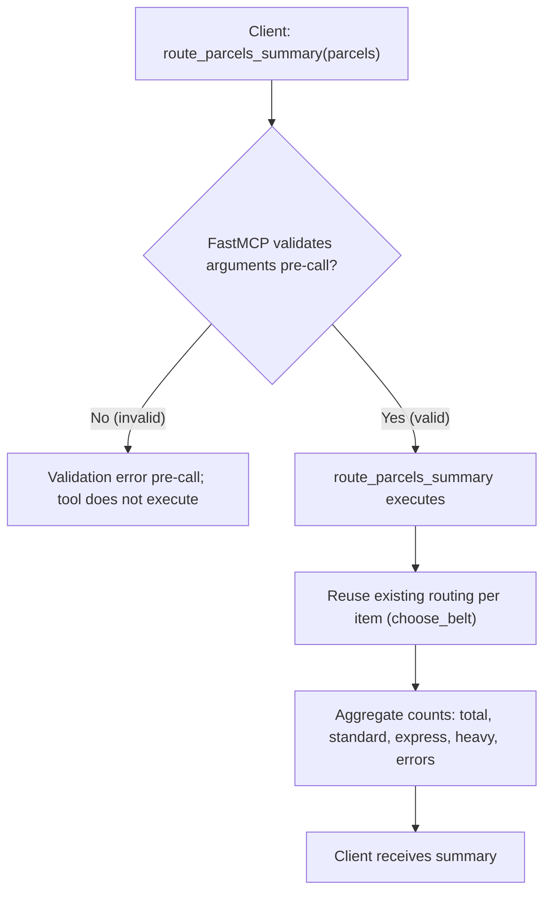

# Design

## Context

ParcelBot уже предоставляет:
- `choose_belt(weight, priority=False)` — бизнес‑правила маршрутизации
- `route_parcel` — одиночная маршрутизация через MCP
- `route_parcels` — batch‑маршрутизация с пер‑элементными результатами

Новая функция: `route_parcels_summary` — агрегированная сводка поверх batch‑маршрутизации.

## Goals / Non-Goals

**Goals:**
- Получить сводку: total, counts по belt (standard/express/heavy), count ошибок
- Переиспользовать существующую логику, не дублировать правила

**Non-Goals:**
- Изменение поведения `choose_belt`, `route_parcel`, `route_parcels`
- Добавление новых типов конвейеров

## Approach (text)

- Валидация входа (FastMCP) для списка `parcels` с полями `weight` (number, required) и `priority` (bool, optional, default False)
- Для корректных аргументов вызвать существующую batch‑маршрутизацию (или эквивалентную итерацию делегирования к `choose_belt`) и подсчитать распределение:
  - `total = len(parcels)`
  - `errors` — количество элементов, получивших domain error (например, non‑positive weight)
  - `standard`/`express`/`heavy` — счётчики по соответствующим belt
- При частичных доменных ошибках продолжать обработку и учитывать остальные элементы

## Diagram (Mermaid)

## Risks / Trade-offs
- Дублирование итерации по элементам вместо прямого вызова `route_parcels` — при необходимости можно рефакторить на общий путь (не в рамках этой фичи)
- Производительность для очень больших batch — вне текущего объёма

## Open Questions
- Нужны ли дополнительные поля сводки (например, counts по boundary case 10)? Предлагаем оставить базовую пятёрку полей согласно спецификации
