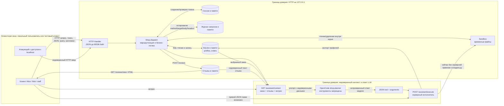

# Модель угроз Mini Shop

## 1. Назначение и область модели

Mini Shop — учебный HTTP-магазин на Python 3.10+ с SQLite в памяти и одноразовым файловым каталогом. Он намеренно содержит ошибки безопасности; данные профилей и чеков синтетические. Модель описывает именно локальную лабораторную конфигурацию, а не готовый интернет-магазин. Источник: `README.md:20-24`, `lab/README.md:1-3, 52-60`.

Сервер принимает HTTP-запросы только на `127.0.0.1` (`lab/service.py:146-161`). Лабораторные проверки атак ограничены собственным процессом Mini Shop и его синтетическими данными; внешние сервисы, удалённые цели и реальные персональные данные не входят в область работ (`lab/README.md:15-17, 52, 60`). `sandbox.py` — неизменяемая физическая граница файловой песочницы; защищать авторизацию к файлам внутри этой границы должен `service.py` (`lab/README.md:54-60`).

Модель угроз описывает исходную уязвимую версию Mini Shop (Before), до внесения исправлений в `lab/service.py`. Указанные в документе ссылки на код и его поведение относятся именно к этой версии.

## 2. Компоненты, пользователи и роли

### Компоненты

- **HTTP-обработчик** читает тело запроса размером до 65 536 байт, разбирает JSON и вызывает диспетчер `Shop.dispatch` под блокировкой (`lab/service.py:117-143`).
- **Shop / диспетчер API** содержит учётные записи, сессии, каталог, отзывы и журнал в памяти; запросы к профилям и заказам обслуживаются SQLite (`lab/service.py:14-39, 41-110`).
- **SQLite** хранит таблицы профилей и заказов. Начальные профили — Alice и Bob, заказы связаны с владельцами (`lab/service.py:18-27`).
- **Файловая песочница** создаёт временный корень, два чека и служебную заметку. `path()` разрешает физический путь и отклоняет выход за корень; `read()` читает, `delete_tree()` удаляет файл или дерево внутри песочницы (`lab/sandbox.py:8-35`).
- **AI-планировщик** — внешний по отношению к HTTP-обработчику этап процесса: `/assistant/context` собирает текстовый prompt из заказа, отзывов и вопроса; настроенный OpenCode-агент `shop-planner` использует `planner-system.txt`, не имеет инструментов и должен вернуть JSON решения (`lab/service.py:88-98`, `planner-system.txt:1-5`, `opencode.json:16-20`).
- **Исполнитель инструментов** — серверный маршрут `/assistant/execute`: принимает решение в JSON и непосредственно вызывает чтение файла, экспорт профилей либо удаление дерева (`lab/service.py:99-109`). Это отдельная граница доверия от решения самой модели.

### Пользователи и роли

| Субъект | Идентичность и права по замыслу |
|---|---|
| Клиент Alice | Учетная запись `alice`, ID 1, роль `customer`; собственные профиль, заказ и чек. |
| Клиент Bob | `bob`, ID 2, роль `customer`; собственные профиль, заказ и чек. |
| Сотрудник | `staff`, ID 0, роль `staff`; разрешённые сотруднику действия, в частности экспорт профилей. |
| Неаутентифицированный клиент / атакующий | Может отправлять запросы к доступному loopback-сервису; не должен получать данные или полномочия пользователей. |
| Содержимое пользовательских данных | Отзывы, query-параметры, JSON-тело и HTTP-заголовки — входные данные, а не источник полномочий. |
| AI-планировщик | Недоверенный источник рекомендаций для сервера; его ответ должен проходить серверную проверку независимо от текста system prompt. |

Учебные логины, ID и намерение выдавать клиенту только собственные профиль/чек перечислены в `lab/README.md:19-29`. Пароли заданы в коде (`lab/service.py:28-33`) и предназначены только для стенда.

## 3. Защищаемые активы

| Актив | Требуемое свойство |
|---|---|
| Профили (имя, email, адрес) | Конфиденциальность; клиент видит свой профиль, сотрудник — только в рамках разрешённых операций. |
| Заказы (владелец, товар, цена) | Конфиденциальность и целостность владения/цены; клиент управляет только своими заказами, цена соответствует каталогу. |
| Чеки Alice и Bob | Конфиденциальность и целостность; выдача только владельцу или явно уполномоченному сценарию. |
| Служебная заметка и файловое дерево | Конфиденциальность заметки, целостность временного содержимого; операции не выходят из корня песочницы. |
| Сессии и полномочия | Токен должен связываться сервером с пользователем и ролью; заголовок клиента не должен повышать права. |
| Журналы запросов | Конфиденциальность заголовков и тел запросов; целостность записи; ограниченный доступ и срок жизни. |
| Отзывы и их HTML-представление | Безопасное хранение и отображение; отзыв не должен выполнять скрипт в браузере или менять полномочия модели. |
| Инструменты AI-помощника и результаты | Ограничение по владельцу заказа, минимальные разрешения, безопасное чтение/удаление, проверка сервером каждого решения. |
| Доступность процесса | Запросы и операции не должны чрезмерно расходовать память, время или удалять нужные учебные файлы. |

Исходные активы подтверждены структурами и начальными значениями в `lab/service.py:18-36, 44, 89-109`, содержимым `lab/sandbox.py:12-19` и перечнем API в `lab/README.md:31-50`.

## 4. Архитектура и потоки данных

Потоки и границы на диаграмме отражают текущий код: обработчик передаёт данные в `dispatch` и логирует вход (`lab/service.py:41-44, 117-138`); маршрут контекста склеивает текст заказа, отзывов и вопроса (`lab/service.py:88-98`); OpenCode-конфигурация запрещает инструменты планировщику (`opencode.json:16-20`), но HTTP-исполнитель — отдельный обработчик (`lab/service.py:99-109`). Диаграмма показывает логические границы доверия, а не утверждает наличие сетевого отдельного сервиса LLM в `service.py`.

## 5. Нарушители, точки входа и сценарии

### Возможные нарушители

1. **Неаутентифицированный локальный пользователь или другой локальный процесс** — отправляет HTTP-запросы на loopback. Сетевой интерфейс вне машины недоступен по текущей привязке (`lab/service.py:146-152`; тест `lab/test_http.py:55-56`).
2. **Злонамеренный или скомпрометированный клиент Alice/Bob** — имеет действительную учебную сессию и пытается читать/менять ресурсы другого клиента либо выдать себе роль сотрудника.
3. **Пользователь, контролирующий содержимое отзыва или вопроса помощнику** — пытается внедрить инструкции в контекст LLM (prompt injection — инструкция в недоверенном тексте, рассчитанная на изменение поведения модели).
4. **Недоверенный/ошибочный ответ LLM или прямой вызывающий `/assistant/execute`** — подаёт опасное решение инструменту независимо от того, повлиял ли отзыв на модель.
5. **Сотрудник или пользователь с украденными учебными учётными данными** — злоупотребляет правами, доступными его сессии. Реалистичность кражи пароля не проверялась; учётные данные в стенде фиксированы.

### Точки входа

Все перечисленные в `lab/README.md:35-50`: `/login`, `/profile`, `/search`, `/orders` (GET/POST), `/admin/export`, `/files`, `/reviews` (POST), `/reviews/view`, `/debug/logs`, `/assistant/context`, `/assistant/execute`; дополнительно `/health` и `/products`. Вход также включает query-параметры, заголовки, JSON-поля и сохранённые отзывы. Транспорт принимает GET и POST через общий обработчик (`lab/service.py:117-138`).

## 6. Существенные угрозы и меры защиты

Статус **«подтверждено кодом»** означает, что опасная конструкция или отсутствие проверки видны непосредственно в данном исходнике; влияние и конкретный способ использования всё равно следует подтвердить лабораторным тестом. Статус **«гипотеза»** отмечает последствия, которые нельзя окончательно установить только чтением кода.

| Угроза и статус | Компонент / API | Источник угрозы | Потенциальные последствия | Необходимые меры защиты | Подтверждение |
|---|---|---|---|---|---|
| **SQL-инъекция в чтении профиля и поиске — подтверждено кодом** | `GET /profile`, `GET /search` | `id` и `q` из query подставляются в SQL-строку | Чтение данных других профилей или изменение смысла запроса; точный эффект зависит от допустимого выражения и драйвера | Параметризованные SQL-запросы; валидация типов/длины; не считать скрытие UI границей защиты | Пользовательский ввод разбирается на `lab/service.py:43`, небезопасная SQL-интерполяция находится на строках `57` (`/profile`) и `59` (`/search`). Поставляемые тесты не проверяют инъекцию (`lab/test_service.py:25-76`). |
| **Нарушение авторизации и IDOR — подтверждено кодом** (IDOR — доступ к чужому объекту через подмену его идентификатора) | `/profile`, `/orders` GET, `/files`, `/assistant/context`, `/assistant/execute` | Неаутентифицированный или залогиненный клиент контролирует ID/путь/решение | Чужой профиль, заказ или чек; вызов чужого действия. Конкретный доступ зависит от пути/инструмента | На каждом маршруте проверять токен; брать ID и роль только из серверной сессии; проверять владельца ресурса и принадлежность заказа перед выдачей | Проверка токена видна только для `POST /orders` (`lab/service.py:62-73`); профили, список заказов, файлы, контекст и исполнитель не читают сессию (`56-61, 78-80, 88-109`). README требует серверного установления владельца/роли (`lab/README.md:27-29`). |
| **Подмена роли через `X-Role` — подтверждено кодом** | `GET /admin/export` | Любой клиент задаёт HTTP-заголовок | Экспорт всех профилей без действительной роли сотрудника | Проверять сессию по `X-Token`, получать роль из серверной записи сессии; неизвестный/отсутствующий токен отклонять | Условие маршрута проверяет только `headers.get("X-Role")` (`lab/service.py:74-77`). Тест staff отправляет заголовок вместе с токеном, но не тестирует подмену (`lab/test_service.py:38-42`). |
| **Подмена цены заказа — подтверждено кодом** | `POST /orders` | Авторизованный клиент передаёт `price` в JSON | Создание заказа с ценой, отличной от каталога; финансовая целостность нарушена | Цена вычисляется на сервере из каталога; поле цены от клиента игнорируется или запрещается; покрыть тестом | Сессия и товар проверяются, но далее берётся `body.get("price", self.products[product])` (`lab/service.py:62-73`). Документированный контракт говорит о покупке по цене каталога (`lab/README.md:29, 43`). |
| **Утечка журналов — подтверждено кодом** | `GET /debug/logs` | Любой вызывающий, маршрут не аутентифицирует | Раскрытие истории запросов, токенов и содержимого тел/заголовков: лог копирует целиком method, target, body, headers | Не включать секреты в логи; требовать административную авторизацию; маскировать токены и чувствительные поля; ограничить объём/срок хранения | Запись всех заголовков и тела (`lab/service.py:44`), без проверки сессии выдаётся копия (`81-82`). Наличие конкретного токена в логах зависит от запроса, но механизм это допускает. |
| **Хранимый XSS в отзывах — подтверждено кодом** (XSS — выполнение внедрённого скрипта в браузере при отображении страницы) | `POST /reviews`, `GET /reviews/view` | Клиент отправляет `text` отзыва | Скрипт в браузере посетителя страницы отзывов, действия от его имени в рамках доступного браузеру | Экранировать текст HTML-контекстно при выводе; безопасная шаблонизация; при необходимости CSP как дополнительный слой | Текст сохраняется напрямую и вставляется в `
` без экранирования (`lab/service.py:83-87`). Наличие уязвимости в браузере зависит от конкретного содержимого и контекста рендеринга. |
| **Чтение произвольных файлов внутри песочницы — подтверждено кодом как отсутствие авторизации** | `/files`, `read_file` в `/assistant/execute` | Путь из query или решения инструмента | Прочтение чужого чека и `private/operator-note.txt`; физический выход за корень при штатном `Sandbox.path` блокируется | Проверять владельца по сессии и разрешать только чек этого владельца; для инструмента отдельно разрешать только узкие операции; не выдавать общий путь от клиента | `/files` строит путь из `user` и `path` и читает без авторизации (`lab/service.py:78-80`); исполнитель читает переданный `arguments.path` (`102-104`). Внутреннюю физическую границу подтверждают `lab/sandbox.py:21-29` и тесты `lab/test_service.py:83-106`. |
| **Удаление файлов через помощника — подтверждено кодом** | `POST /assistant/execute`, `delete_tree` | Прямой HTTP-клиент или недоверенное решение LLM | Удаление чеков, служебной заметки или всего временного дерева песочницы; потеря состояния текущего запуска | Удалить инструмент, если он не нужен; иначе требовать серверной авторизации и подтверждения, ограничить путь конкретным объектом/операцией и проверять владельца | Исполнитель вызывает `delete_tree(arguments["path"])` без проверки сессии/полномочий (`lab/service.py:99-109`). Сам `Sandbox.delete_tree` удаляет переданный файл/каталог внутри корня (`lab/sandbox.py:30-35`); README предупреждает, что возможно удалить всё учебное дерево, оставаясь в его границах (`lab/README.md:56-60`). |
| **Экспорт профилей через инструмент — подтверждено кодом** | `/assistant/execute`, `export_profiles` | Любой вызывающий исполнитель | Массовое раскрытие обоих профилей, включая контактные данные | Проверка токена и роли на сервере, отдельная политика для конкретного инструмента; минимальный набор возвращаемых полей | Инструмент делает `SELECT * FROM profiles` без авторизации (`lab/service.py:99-109`); состав полей таблицы задан в `18-24`. |
| **Prompt injection в контексте помощника — граница модели и сервера** | `/reviews`, `/assistant/context`, planner, `/assistant/execute` | Текст отзыва, вопрос пользователя или иные контролируемые данные в prompt | Модель может сформировать решение `export_profiles`, `read_file` или `delete_tree`; последствия реализуются только если сервер примет и исполнит его | Считать отзывы/заказ/вопрос недоверенными; отделять данные от инструкций; планировщику отказать в опасной просьбе; главное — серверная авторизация каждого инструмента по сессии, владельцу, роли и разрешённой операции; проверять принудительные опасные решения отдельно | Контекст включает отзывы, заказ и вопрос (`lab/service.py:88-98`). System prompt запрещает раскрытие и удаление и объявляет контекст недоверенным (`planner-system.txt:1-5`), конфиг запрещает модели инструменты (`opencode.json:16-20`). Но `/assistant/execute` напрямую принимает три операции и не проверяет сессию (`lab/service.py:99-109`). Факт, что конкретная модель подчинится атакующему отзыву, **не подтверждён кодом** и требует отдельного модельного эксперимента. |
| **Ошибка обработки входа раскрывает детали исключения — гипотеза для оценки воздействия** | Все POST-маршруты, общий HTTP-обработчик | Некорректный JSON, отсутствующие/неверные поля, неверные типы | Ответ `500` может раскрыть сообщение исключения и тип; возможно ухудшение доступности через повторные ошибки | Проверять схему и типы входа; возвращать нейтральные ошибки; ограничивать частоту запросов | Общий `except` сериализует `str(exc)` и имя типа (`lab/service.py:119-135`). Чувствительность конкретных сообщений и практическое влияние требуют проверки. |
| **Злоупотребление частотой запросов — гипотеза** | HTTP API в целом | Локальный процесс или клиент | Рост нагрузки/памяти; отзывы и логи накапливаются в списках без показанной очистки | Ограничение частоты, лимиты записей и времени жизни, эксплуатационный контроль | `reviews` и `logs` — списки в памяти (`lab/service.py:35-36`), запросы записываются (`44`); rate limiting в показанном обработчике отсутствует (`117-143`). Реальное истощение ресурсов при стендовых лимитах требует эксперимента. |

### Остальные важные свойства и границы

- Пароль проверяется сравнением с фиксированными значениями, а успешный вход создаёт случайный UUID-токен без видимых срока действия или отзыва (`lab/service.py:28-33, 49-55`). Это подтверждает ограниченность учебной реализации; атака на угадывание токена или злоупотребление сроком его жизни не демонстрировалась.
- `POST /orders` использует параметризованный INSERT для значений владельца, товара и цены (`lab/service.py:70-71`); угроза здесь — не SQL-инъекция в INSERT, а доверие к клиентской цене и отсутствие иных ограничений.
- `Sandbox.path()` разрешает физические пути и проверяет, что результат остаётся в корне; тесты проверяют `..`, абсолютный путь, symlink и удаление корня только внутри стенда (`lab/sandbox.py:21-35`, `lab/test_service.py:83-115`). Модель не предполагает обхода этой границы или изменения `sandbox.py`.
- Сервер — loopback-only, стандартный `ThreadingHTTPServer`; лаборатория не предоставляет shell, Python execution или сетевую отправку по URL (`lab/service.py:146-152`, `lab/README.md:60`). Эти классы атак не входят в допустимую проверку.
- Размер HTTP тела ограничен 65 536 байтами (`lab/service.py:121-125`), но это само по себе не является полноценной защитой доступности.

## 7. Prompt injection: две независимые проверки

**Уровень модели.** `GET /assistant/context` формирует текст из заказа, всех отзывов и вопроса пользователя. Отзыв — недоверенное содержимое, способное содержать инструкции, конфликтующие с назначением помощника. `planner-system.txt` задаёт запрет раскрытия чужих данных и удаления, запрещает вызов инструментов и требует JSON; `opencode.json` запускает агента без разрешённых инструментов. Это снижает риск на уровне планирования, но не создаёт серверной границы авторизации. Из исходников нельзя вывести, выполнит ли конкретная LLM вредоносную инструкцию: это экспериментальный вопрос.

**Уровень сервера.** `/assistant/execute` принимает `decision` от HTTP-клиента; код не подтверждает его происхождение от `shop-planner` и не связывает его с аутентифицированной сессией или владельцем заказа. Поэтому ручная отправка опасного JSON — проверка контроля доступа исполнителя, а не доказательство prompt injection. Сервер обязан отвергать запрещённую операцию даже при ошибке или неповиновении модели.

Процедура различения этих результатов описана в `lab/README.md:62-73`: сохранить точный контекст, ответ модели и действие исполнителя; повторить с вредоносным отзывом; после исправлений повторить модельную проверку и отдельно принудительно передать опасное решение. Настоящая модель угроз фиксирует такие тесты как будущие, не как уже выполненные.

## 8. Основания, пробелы и открытые вопросы

### Подтверждено исходниками

- Намеренная уязвимость сервиса и синтетичность данных (`README.md:20-24`, `lab/README.md:1-3, 52`).
- Привязка HTTP-сервера к loopback (`lab/service.py:146-152`; `lab/test_http.py:55-56`).
- Наличие SQL-конкатенации, проверок отдельных сессий, записи/выдачи логов, HTML-конкатенации отзывов, формирования контекста и трёх инструментов исполнения (соответствующие строки указаны в таблице угроз).
- Физическая защита sandbox от выхода путей за временный корень и наличие тестов на это (`lab/sandbox.py:21-35`, `lab/test_service.py:83-115`).
- Разделение prompt injection и прямого доступа к исполнителю, прямо предписанное инструкцией лаборатории (`lab/README.md:64-73`).

### Требует эксперимента или уточнения

- Фактические ответы API на конкретные SQL-инъекционные строки и пределы чтения/изменения данных.
- Достижимость и контекст выполнения XSS в браузере; типы клиентов, просматривающих отзывы, в коде не заданы.
- Поведение выбранной модели на злонамеренном отзыве, повторяемость результата и валидность JSON.
- Фактический охват удаления для конкретного пути, в том числе путь к корню песочницы, и последующие ошибки сервиса.
- Реальные секреты, содержащиеся в журналах для разных запросов, и практическая чувствительность исключений.
- Эксплуатационное влияние неограниченного накопления логов/отзывов и отсутствие rate limiting.
- Точное разграничение действий сотрудника за пределами экспорта: README говорит о разрешённых действиях, но полный бизнес-контракт роли здесь не определён.

Модель не утверждает, что перечисленные атаки уже воспроизведены. Для них нужны изолированные тесты только против собственного локального Mini Shop; сетевые внешние атаки, реальные пользовательские данные и расширение файлового sandbox исключены (`lab/README.md:15-17, 54-60`).
